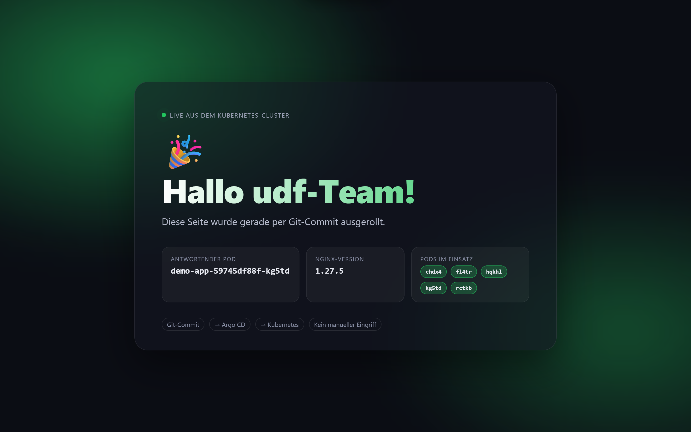

# GitOps-Demo: Deployen per Git-Commit

Eine kleine Webseite (nginx) als Helm-Chart. **Argo CD** holt sie aus diesem Repo und baut sie in einem lokalen Kubernetes-Cluster auf.
Änderst du `chart/values.yaml` und pushst, zeigt Argo CD „OutOfSync“. Ein Klick auf **SYNC**, und die Webseite ändert sich live.



## Was liegt wo?

| Pfad | Inhalt |
|---|---|
| `chart/values.yaml` | **Die Demo-Datei:** Titel, Emoji, Farbe, Anzahl Pods |
| `chart/files/index.html` | Der Code der Webseite |
| `argocd/demo-app.yaml` | App-Definition zum Einfügen in Argo CD („+ NEW APP → EDIT AS YAML“) |
| `argocd/argocd-values.yaml` | Einstellungen für die Argo-CD-Installation |
| `docs/` | [Spickzettel für die Demo](docs/Anleitung.md) ([als ODT](docs/Anleitung.odt)) |
| `slides/` | Präsentation ([PDF](slides/praesentation.pdf) · [PPTX](slides/praesentation.pptx) · [Sprechernotizen](slides/sprechernotizen.txt)) |

## Nachbauen (Windows, PowerShell)

```powershell
k3d cluster create gitops-demo -p "80:80@loadbalancer"
helm upgrade --install argocd oci://ghcr.io/argoproj/argo-helm/argo-cd --version 10.19.1 -n argocd --create-namespace -f argocd/argocd-values.yaml --wait
```

Danach <http://argocd.localhost> öffnen und weiter wie im [Demo-Ablauf](docs/Anleitung.md#demo-ablauf) beschrieben.
