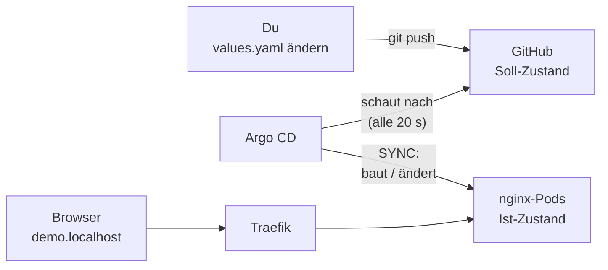
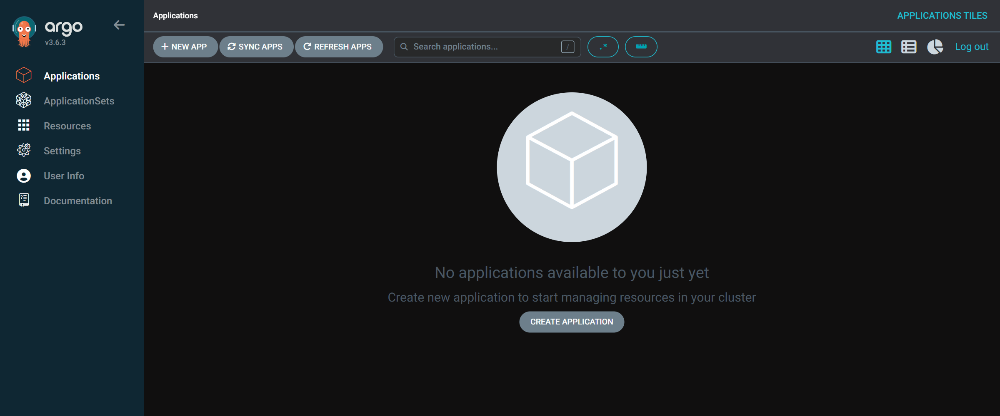
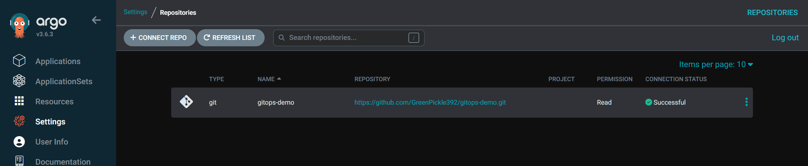

# GitOps-Demo – Spickzettel

## Worum geht's?

Eine kleine Webseite liegt als Code auf GitHub. Argo CD schaut in dieses Repo und baut die Webseite in einem Kubernetes-Cluster auf deinem Laptop auf.
Änderst du etwas in Git, zeigt Argo CD „da ist was anders“. Ein Klick auf **SYNC**, und die Webseite ändert sich.


## Was läuft wo?

```
Dein Laptop
└─ Docker Desktop
   ├─ k3d-gitops-demo-serverlb  → leitet Port 80 in den Cluster
   └─ k3d-gitops-demo-server-0  → kleiner Kubernetes-Cluster (k3s)
      ├─ argocd       → Argo CD
      ├─ kube-system  → Traefik (Eingangstür) + Helfer
      └─ demo         → Webseite (nginx), erst nach SYNC
```

Die „Bereiche“ heißen in Kubernetes **Namespaces**. Ein **Pod** ist eine laufende Instanz mit (hier) genau einem Container drin.

| Bereich | Pod | Was macht der? |
|---|---|---|
| demo | `demo-app-…` | **nginx-Webserver** = die Webseite. Erst 1 Pod, später 5. |
| argocd | `argocd-server-…` | Die **Weboberfläche** von Argo CD (<http://argocd.localhost>) |
| argocd | `argocd-repo-server-…` | **Holt das Repo von GitHub** und macht aus dem Helm-Chart fertige Kubernetes-Bausteine |
| argocd | `argocd-application-controller-0` | **Vergleicht** Git (Soll) mit dem Cluster (Ist) und führt den **Sync** aus |
| argocd | `argocd-redis-…` | Zwischenspeicher für Argo CD |
| argocd | `argocd-applicationset-controller-…` | Wird in der Demo nicht gebraucht |
| kube-system | `traefik-…` | **Eingangstür:** schickt `demo.localhost` zur Webseite und `argocd.localhost` zu Argo CD |
| kube-system | `coredns`, `metrics-server`, `local-path-provisioner`, `svclb-traefik` | Kubernetes-eigene Helfer, für die Demo egal |

Selbst nachschauen: `kubectl get pods -A`



## Woher kennt Argo CD mein Repo?

An **zwei Stellen**, beide in Argo CD:

1. **In der App** (`argocd/demo-app.yaml`, Zeile `repoURL:`). Das ist die eigentliche Verbindung: „Nimm den Ordner `chart` aus diesem Repo, Branch `main`, und bau ihn in den Bereich `demo`.“
2. **Unter Settings → Repositories** (optional). Dort trägst du das Repo ein und Argo CD testet, ob es rankommt („Successful“). Gespeichert wird das als Secret im Bereich `argocd`. Für **private** Repos stehen dort Benutzername und Token. Unser Repo ist **öffentlich**, deshalb braucht Argo CD kein Passwort.

Argo CD **holt** sich den Stand selbst (Pull). GitHub schickt nichts in deinen Cluster.

## Die Dateien im Repo

| Datei | Was ist das? |
|---|---|
| `chart/values.yaml` | **Die Datei für die Demo:** Titel, Emoji, Farbe, Anzahl Pods |
| `chart/files/index.html` | Der Code der Webseite (zum Zeigen in GitHub) |
| `chart/templates/` | Bauplan für Kubernetes: Deployment, Service, Ingress, ConfigMap |
| `argocd/demo-app.yaml` | Die App-Definition zum Einfügen in Argo CD |
| `argocd/argocd-values.yaml` | Einstellungen für die Installation von Argo CD |

## Einmal einrichten (auf deinem Laptop schon erledigt)

Nur zur Info, falls du es auf einem anderen Rechner nachbauen willst. Alles in PowerShell, keine Skripte nötig:

```powershell
winget install Docker.DockerDesktop
winget install k3d.k3d
winget install Helm.Helm
# Docker Desktop einmal starten, dann:
k3d cluster create gitops-demo -p "80:80@loadbalancer"
helm upgrade --install argocd oci://ghcr.io/argoproj/argo-helm/argo-cd --version 10.19.1 -n argocd --create-namespace -f argocd/argocd-values.yaml --wait
```

**Argo-CD-Passwort** (Benutzer `admin`) anzeigen:

```powershell
[Text.Encoding]::UTF8.GetString([Convert]::FromBase64String((kubectl -n argocd get secret argocd-initial-admin-secret -o jsonpath='{.data.password}')))
```

## Vor dem Talk

- [ ] Docker Desktop starten. Der Cluster startet mit (sonst: `k3d cluster start gitops-demo`).
- [ ] Browser-Tabs öffnen:
  1. GitHub: <https://github.com/GreenPickle392/gitops-demo>
  2. Argo CD: <http://argocd.localhost>, einloggen. Es sollte **leer** sein.
  3. Webseite: <http://demo.localhost>. Sie zeigt jetzt „404 page not found“, das ist richtig so.
- [ ] Editor mit `chart/values.yaml` offen, Schrift groß.
- [ ] `argocd/demo-app.yaml` öffnen und den Inhalt kopieren (brauchst du in Schritt 3).
- [ ] Terminal im Repo-Ordner, Schrift groß.
- [ ] **Internet** an (Argo CD holt von GitHub), Handy-Hotspot als Reserve. Benachrichtigungen aus.

## Demo-Ablauf



### 1. Code in GitHub zeigen

Zeig in GitHub `chart/files/index.html` (die Webseite) und `chart/values.yaml` (die Stellschrauben).
*„Alles, was gleich läuft, steht hier im Git, und sonst nirgends.“*

### 2. Leeres Argo CD zeigen

Argo CD zeigt „No applications available“. Die Webseite gibt 404.
*„Der Cluster läuft, Argo CD läuft, aber es weiß noch nichts von meiner App.“*

### 3. Argo CD mit dem Repo verbinden → Webseite ist da

1. **Settings → Repositories → + CONNECT REPO**
   - Oben „VIA SSH“ auf **VIA HTTPS** umstellen
   - Type: `git`, Name: `gitops-demo`, Project: leer lassen
   - Repository URL: `https://github.com/GreenPickle392/gitops-demo.git`
   - **CONNECT**. Der Status zeigt **Successful**.

   

2. **Applications → + NEW APP → EDIT AS YAML.** Den Inhalt von `argocd/demo-app.yaml` einfügen → **SAVE** → **CREATE**.
3. Die App erscheint **gelb: OutOfSync / Missing**. Soll und Ist passen nicht zusammen, denn im Cluster ist noch nichts.
4. Klick auf die App → **SYNC → SYNCHRONIZE.** Der Baum baut sich auf: Deployment → ReplicaSet → Pod, dazu Service, Ingress und ConfigMap.
5. Webseite mit **F5** neu laden → sie ist da.

*„Ich habe Argo CD nur gesagt, wo mein Repo liegt. Gebaut hat es alles selbst.“*

### 4. Webseite ändern über `values.yaml`

1. In `chart/values.yaml` z. B. ändern:
   `title: "Hallo vom Teamtreffen!"`, `emoji: "🎉"`, `accentColor: "#22c55e"` (grün)
2. Speichern und im Terminal:

   ```powershell
   git commit -am "Neuer Look"; git push
   ```

3. In Argo CD auf **REFRESH** klicken (oder bis zu 20 s warten). Die App wird gelb: **OutOfSync**.
   Tipp: **DIFF** zeigt genau, was sich geändert hat.
4. **SYNC → SYNCHRONIZE.** Ein neuer Pod startet, der alte verschwindet.
5. Die Webseite wechselt **ohne Neuladen**: Hinweis „Neu ausgerollt ✨“, die Farbe blendet über.

Gut zu wissen: Ein paar Sekunden lang springt die Seite zwischen alt und neu hin und her. Kurz laufen alter und neuer Pod gleichzeitig, so geht ein Update ohne Ausfall.
*„Ich habe nur Git geändert. Argo CD sieht den Unterschied und rollt ihn aus.“*

### 5. Selbstheilung: Deployment löschen, dann Sync

1. Im Baum beim Kasten **demo-app (deploy)** auf **⋮ → Delete** und bestätigen (Voreinstellung lassen).
2. Deployment, ReplicaSet und Pod verschwinden. Die App wird gelb, **OutOfSync**: Argo CD merkt, dass etwas fehlt.
   Auf der Webseite verschwinden die Pod-Chips. Mit F5 kommt „404“.
3. **SYNC → SYNCHRONIZE.** Alles ist wieder da, die Webseite läuft.

*„Git ist die Wahrheit. Was jemand im Cluster kaputt macht, stellt Argo CD aus Git wieder her.“*

Bonus: Löschst du nur einen **Pod** (⋮ → Delete beim Kasten „pod“), startet Kubernetes **sofort von selbst** einen neuen, ganz ohne Argo CD. Das ist die Selbstheilung von Kubernetes. Argo CD bleibt grün, weil der Bauplan (Deployment) ja noch stimmt.

### 6. Hochskalieren auf 5 Pods

1. In `values.yaml`: `replicaCount: 5` → speichern → `git commit -am "5 Pods"; git push`
2. **REFRESH** → OutOfSync → **SYNC → SYNCHRONIZE**
3. Im Baum hängen jetzt **5 Pods** am ReplicaSet. Auf der Webseite erscheinen 5 Chips unter „Pods im Einsatz“, und „Antwortender Pod“ wechselt ständig: Die Last wird verteilt.

*„Mehr Kapazität ist eine Zahl in einer Datei.“*


> **Warum klicke ich SYNC selbst?** Damit man jeden Schritt sieht. Argo CD kann das auch automatisch: In der App unter „Sync Policy“ auf **Automatic** stellen und **Self Heal** anhaken. Dann wird jede Änderung und jede Sabotage ohne Klick korrigiert.

## Nach dem Talk: zurück auf Anfang

1. Argo CD: App öffnen → **DELETE** → Namen `demo-app` eintippen → OK. Die Webseite ist weg.
2. Argo CD: **Settings → Repositories** → ⋮ → **Disconnect**.
3. `values.yaml` zurücksetzen (der Git-Tag `demo-start` merkt sich den Anfangszustand):

   ```powershell
   git checkout demo-start -- chart/values.yaml; git commit -m "Zurückgesetzt"; git push
   ```

## Wenn was hakt

| Problem | Lösung |
|---|---|
| `argocd.localhost` / `demo.localhost` lädt nicht | Läuft Docker Desktop? `kubectl get nodes` muss „Ready“ zeigen. Edge oder Chrome nehmen (die kennen `*.localhost`). |
| Webseite zeigt 404 | Normal, solange die App nicht gesynct ist (Schritte 2 und 5). |
| Nach dem Push bleibt Argo grün | **REFRESH** klicken. Wirklich gepusht? `git status` |
| CONNECT REPO zeigt „Failed“ | URL genau prüfen, Internet da? |
| Login in Argo CD klappt nicht | Benutzer `admin`, Passwort mit dem Befehl oben holen |
| PowerShell meckert über „nicht signierte Skripte“ | Betrifft nur `.ps1`-Dateien. Die Demo braucht keine. Die Befehle oben tippst du direkt ein. |
