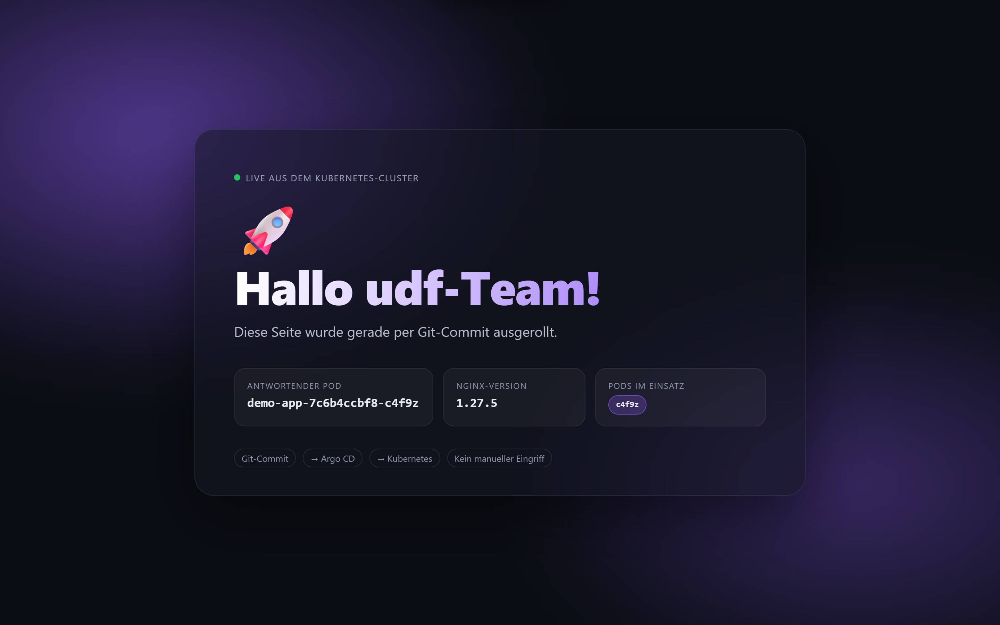
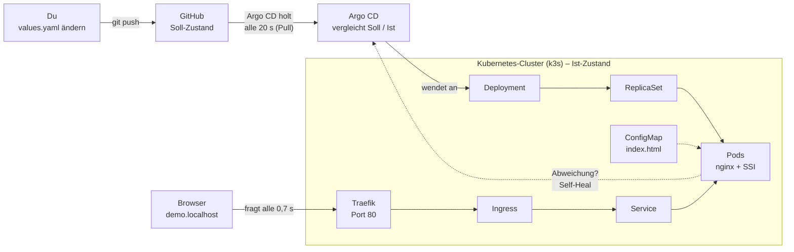
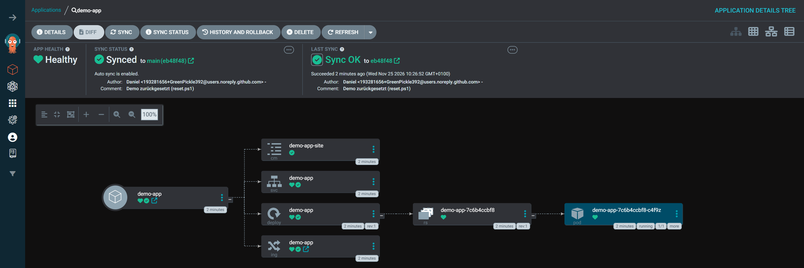

# GitOps-Demo – Anleitung

Kubernetes + Argo CD auf deinem Windows-Laptop: Deployen per Git-Commit, live vor Publikum.

## 1. Überblick

Du änderst eine Zeile in `chart/values.yaml` (Text, Emoji, Farbe, Anzahl Pods oder nginx-Version), machst `git commit` und `git push`, sonst nichts.
Argo CD im lokalen Kubernetes-Cluster merkt die Änderung auf GitHub, gleicht den Cluster an und die kleine Webseite ändert sich live, ohne Neuladen.
Zusätzlich zeigt die Demo Selbstheilung (jemand pfuscht am Cluster herum, Argo CD dreht es zurück) und Rollback per `git revert`.



## 2. Komponenten und Zusammenspiel

| Komponente | Aufgabe |
|---|---|
| **Git / GitHub** | Das Repo ist der **Soll-Zustand**. Jede Änderung ist ein Commit mit Autor und Zeitstempel. Öffentlich, damit Argo CD keine Zugangsdaten braucht. |
| **Argo CD** | GitOps-Controller im Cluster. Holt alle 20 s den Stand aus Git, vergleicht ihn mit dem Cluster und gleicht an (Auto-Sync, Prune, Self-Heal). |
| **Kubernetes (k3s)** | Der Cluster. Läuft lokal als k3s in Docker (k3d). Sorgt dafür, dass immer die gewünschte Zahl Pods läuft. |
| **Traefik** | Ingress-Controller (bei k3s dabei). Nimmt Anfragen auf Port 80 an und leitet `demo.localhost` und `argocd.localhost` weiter. |
| **Helm-Chart** (`chart/`) | Vorlage für alle Kubernetes-Objekte der Webseite. `values.yaml` sind die Stellschrauben für die Demo. |
| **ConfigMap** | Enthält die HTML-Seite und die nginx-Konfiguration. Ändert sich der Inhalt, ändert sich eine Prüfsumme und die Pods werden neu ausgerollt. |
| **Deployment → ReplicaSet → Pods** | Das Deployment beschreibt „so viele Pods mit diesem Image“. Für jede Version gibt es ein ReplicaSet, das die Pods erzeugt. Updates laufen als Rolling Update ohne Ausfall. |
| **Service** | Feste interne Adresse, verteilt Anfragen auf alle Pods (Lastverteilung). |
| **Ingress** | Regel für Traefik: `demo.localhost` → Service `demo-app`. |
| **nginx mit SSI** | Webserver im Pod. Über Server Side Includes setzt er Pod-Name und nginx-Version in die Seite ein. So sieht man, welcher Pod antwortet. |



Die Dateien im Repo:

```
bootstrap/argocd-values.yaml   Einstellungen für Argo CD (Ingress, 20-s-Abfrage)
bootstrap/root-app.yaml        "App of Apps": verwaltet alles unter apps/
apps/demo-app.yaml             Argo-CD-Application für die Webseite
chart/                         Helm-Chart der Webseite – values.yaml ist die Demo-Datei
scripts/                       PowerShell-Skripte (setup, check, chaos, reset, …)
```

## 3. Einmalige Einrichtung auf Windows

### Voraussetzungen

Du brauchst einen Kubernetes-Cluster mit Traefik. Am einfachsten geht es mit einem dieser beiden Wege:

**Weg A – Docker Desktop + k3d** (so ist es auf dem Demo-Laptop eingerichtet):

```powershell
winget install Docker.DockerDesktop
winget install k3d.k3d
winget install Helm.Helm
winget install Git.Git
```

`kubectl` bringt Docker Desktop mit. Starte Docker Desktop einmal und warte, bis es „Engine running“ meldet.

**Weg B – Rancher Desktop** (alles in einem: k3s, kubectl, helm, docker):

```powershell
winget install SUSE.RancherDesktop
```

In den Einstellungen: Kubernetes an, Container-Engine „dockerd (moby)“, Traefik an.
Bei diesem Weg entfällt `k3d-cluster.ps1`.

### Ausführungsrichtlinie für Skripte

Windows blockiert unsignierte Skripte. Gib in jedem neuen PowerShell-Fenster einmal ein:

```powershell
Set-ExecutionPolicy -Scope Process Bypass
```

Das gilt nur für dieses Fenster. Alternativ rufst du ein Skript einzeln so auf:
`powershell -ExecutionPolicy Bypass -File .\scripts\setup.ps1`.
Alle Skripte laufen in Windows PowerShell 5.1 und in PowerShell 7.

### Repo holen und alles aufbauen

```powershell
git clone https://github.com/GreenPickle392/gitops-demo.git
cd gitops-demo
Set-ExecutionPolicy -Scope Process Bypass
.\scripts\k3d-cluster.ps1     # nur Weg A: legt den Cluster an (Traefik auf Port 80)
.\scripts\setup.ps1           # Argo CD + Demo-App, ca. 1,5 Minuten
```

`setup.ps1` macht der Reihe nach:

1. Prüft Werkzeuge, Kube-Kontext, Cluster und Traefik.
2. Installiert oder aktualisiert Argo CD per Helm (Chart-Version fest eingetragen).
3. Wartet, bis alle Argo-CD-Komponenten laufen.
4. Lädt `nginx:1.27-alpine` und `nginx:1.29-alpine` vorab in den Cluster.
5. Legt die Root-Application an. Ab hier arbeitet nur noch Argo CD.
6. Wartet auf „Synced / Healthy“, prüft die Webseite, kopiert das Argo-CD-Passwort in die Zwischenablage und öffnet beide Browser-Tabs.

Das Skript kannst du beliebig oft ausführen. Es baut nichts doppelt.

- Webseite: <http://demo.localhost>
- Argo CD: <http://argocd.localhost>, Benutzer `admin`, Passwort mit Strg+V aus der Zwischenablage

> **Eigene Kopie des Repos?** Forke es und trage deine Repo-URL in `bootstrap/root-app.yaml` und `apps/demo-app.yaml` ein. Argo CD liest immer aus dem Repo, das dort steht.



## 4. Vor dem Talk (Checkliste)

- [ ] Docker Desktop läuft. Der k3d-Cluster startet automatisch mit.
- [ ] `.\scripts\check.ps1` zeigt alles grün.
- [ ] Für den Live-Bootstrap (Schritt 1): `.\scripts\reset.ps1 -OhneApp`. Dann zeigt `check.ps1` bei der Demo-App ein gelbes ○, das ist so gewollt.
- [ ] `.\scripts\open-demo.ps1`: öffnet Argo CD und die Webseite und kopiert das Passwort. Einloggen.
- [ ] Browser-Tabs anordnen: links Argo CD, rechts die Webseite. Beide auf etwa 125 % zoomen.
- [ ] Editor (z. B. VS Code) mit `chart/values.yaml` offen, Schrift groß (Strg + Plus).
- [ ] Terminal im Repo-Ordner, Schrift groß, `Set-ExecutionPolicy -Scope Process Bypass` schon ausgeführt.
- [ ] Benachrichtigungen aus (Windows: „Nicht stören“), Mail und Chat zu.
- [ ] **Internet nötig:** Argo CD holt den Stand von GitHub. Handy-Hotspot als Plan B bereithalten.
- [ ] **Plan C:** eine Bildschirmaufnahme eines erfolgreichen Durchlaufs (Win + Alt + R mit der Xbox Game Bar oder OBS) griffbereit.

## 5. Demo-Drehbuch

Schreib Commits im Terminal so (oder per Git-Ansicht im Editor):

```powershell
git commit -am "Neuer Look"; git push
```

> **Tempo:** Argo CD fragt alle 20 Sekunden bei GitHub nach. Wenn du nicht warten willst, klick in Argo CD auf **REFRESH**. Dann holt es den Stand sofort.

### Schritt 1 – Bootstrap: ein Befehl baut alles

- **Aktion:** `.\scripts\setup.ps1 -NoBrowser` (vorher `reset.ps1 -OhneApp`, siehe Checkliste). Dauert etwa 20 Sekunden.
- **Das sieht das Publikum:** In Argo CD erscheinen `gitops-demo` und dann `demo-app`. Klick auf `demo-app`: Der Baum wächst von Deployment über ReplicaSet zum Pod, dazu Service, Ingress und ConfigMap. Danach lädt die Webseite.
- **Satz:** „Ich sage Argo CD nur, wo mein Git-Repo liegt. Alles andere baut es selbst auf.“

*Ohne Live-Bootstrap:* Zeig einfach den fertigen Baum und erklär ihn.

### Schritt 2 – Text, Emoji und Farbe ändern

- **Aktion:** In `values.yaml` z. B. `title: "Hallo vom Teamtreffen!"`, `emoji: "🎉"`, `accentColor: "#22c55e"` → commit und push.
- **Das sieht das Publikum:** Nach höchstens 20 s wird Argo CD kurz „OutOfSync“, dann „Syncing“. Ein neues ReplicaSet mit neuem Pod entsteht, der alte verschwindet. Auf der Webseite erscheint der Hinweis „Neu ausgerollt ✨“ und die Farbe wechselt weich.
- **Wichtig:** Während des Rolling Updates springt die Seite ein paar Sekunden zwischen altem und neuem Stand hin und her. Das ist kein Fehler. Kurz laufen alter und neuer Pod gleichzeitig, und der Service verteilt die Anfragen auf beide. Genau so geht ein Update ohne Ausfall. Unbedingt darauf hinweisen!
- **Satz:** „Ich habe nicht den Server angefasst, sondern nur Git, und der Cluster zieht nach.“

### Schritt 3 – Auf 5 Pods skalieren

- **Aktion:** `replicaCount: 5` → commit und push.
- **Das sieht das Publikum:** In Argo CD hängen 5 Pods am ReplicaSet. Auf der Webseite tauchen unter „Pods im Einsatz“ nach und nach 5 Chips auf, und „Antwortender Pod“ wechselt ständig: Lastverteilung live.
- **Satz:** „Mehr Kapazität ist eine Zahl in einer Datei, und jede Anfrage landet bei einem anderen Pod.“

### Schritt 4 – Selbstheilung

- **Aktion:** `.\scripts\chaos.ps1` löscht das Deployment von Hand, so als würde jemand direkt im Cluster eingreifen. Variante: `.\scripts\chaos.ps1 -Modus skalieren` dreht von Hand auf 0 Pods.
- **Das sieht das Publikum:** Das Skript meldet „Sabotage!“. In Argo CD verschwindet der Baum kurz und ist nach wenigen Sekunden wieder da. Das Skript zeigt „Selbstheilung nach x s“. Die Webseite ist höchstens kurz weg.
- **Satz:** „Git ist die Wahrheit. Wer am Cluster vorbei etwas ändert, wird von Argo CD überstimmt.“

### Schritt 5 – Versions-Upgrade nginx 1.27 → 1.29

- **Aktion:** `tag: "1.29-alpine"` → commit und push.
- **Das sieht das Publikum:** Rolling Update Pod für Pod: Erst kommt ein neuer Pod dazu, dann geht ein alter. In der Kachel „nginx-Version“ wechselt die Anzeige von 1.27.x auf 1.29.x. Die Seite bleibt die ganze Zeit erreichbar.
- **Satz:** „So spielen wir Sicherheits-Updates ein: per Pull Request, mit Review, ohne Wartungsfenster.“

### Schritt 6 – Rollback per `git revert`

- **Aktion:**

  ```powershell
  git revert HEAD --no-edit; git push
  ```

- **Das sieht das Publikum:** Ein neuer Commit „Revert …“. Argo CD rollt wieder 1.27 aus, die Kachel zeigt 1.27.x. In GitHub sieht man die komplette Historie.
- **Satz:** „Rollback heißt: den letzten Commit rückgängig machen. Nachvollziehbar, wer, wann und warum.“

## 6. Nach dem Talk

```powershell
.\scripts\reset.ps1             # values.yaml auf Start, commit + push, wartet auf Argo CD
.\scripts\reset.ps1 -OhneApp    # zusätzlich die Demo-App entfernen (für den nächsten Live-Bootstrap)
.\scripts\teardown.ps1          # Argo CD und alles andere entfernen (fragt nach)
.\scripts\teardown.ps1 -ClusterLoeschen   # zusätzlich den k3d-Cluster löschen
```

`reset.ps1` holt sich den Startzustand aus `scripts/values.start.yaml`. Willst du einen anderen Startzustand, ändere diese Datei.

## 7. Fehlerbehebung

**Port 80 ist belegt** (z. B. IIS, Skype, ein anderer Container):
Prüfen mit `Get-NetTCPConnection -State Listen -LocalPort 80`. Entweder den Dienst stoppen (IIS: `iisreset /stop`) oder einen anderen Port nehmen:

```powershell
.\scripts\teardown.ps1 -ClusterLoeschen -Force
.\scripts\k3d-cluster.ps1 -Port 8088
$env:DEMO_PORT = 8088        # in jedem Fenster, bevor du die Skripte startest
.\scripts\setup.ps1
```

Die URLs sind dann `http://demo.localhost:8088` und `http://argocd.localhost:8088`.

**Argo CD synchronisiert nicht oder nur langsam:**

- In Argo CD auf **REFRESH** klicken. Damit holt es den Stand sofort.
- Wirklich gepusht? `git status` und `git log origin/main -1`.
- Der Abfrageintervall steht in `bootstrap/argocd-values.yaml` (`timeout.reconciliation: 20s`). Nach einer Änderung `setup.ps1` erneut ausführen.
- Internet weg? `check.ps1` zeigt „GitHub nicht erreichbar“ → Hotspot.
- App steht auf „Unknown“ oder zeigt einen Fehler: Klick auf die App → „App Conditions“ zeigt die Fehlermeldung (z. B. YAML-Tippfehler in `values.yaml`). Fix committen und pushen, oder `git revert HEAD`.

**Image kann nicht geladen werden** (Pod in `ImagePullBackOff`):
Meist fehlt Internet oder der Tag ist falsch geschrieben. `setup.ps1` lädt beide Demo-Images vorab. `check.ps1` zeigt, ob sie im Cache liegen. Tippfehler im Tag korrigieren und pushen.

**`demo.localhost` öffnet nicht:**
Chrome und Edge lösen `*.localhost` automatisch auf 127.0.0.1 auf. Andere Browser (z. B. Firefox) teils nicht. Dann Edge oder Chrome nehmen oder in `C:\Windows\System32\drivers\etc\hosts` (als Administrator) eintragen:

```
127.0.0.1 demo.localhost argocd.localhost
```

**„Die Ausführung von Skripts ist auf diesem System deaktiviert“:**
`Set-ExecutionPolicy -Scope Process Bypass` im aktuellen Fenster, dann das Skript erneut starten. Wurde das Repo als ZIP geladen, zusätzlich: `Get-ChildItem .\scripts | Unblock-File`.

**Cluster nicht erreichbar** (`check.ps1`: Node nicht Ready):
Docker Desktop starten, eine Minute warten. Hilft das nicht: `k3d cluster start gitops-demo`.

**Helm meldet „no cached repo found“:**
Kommt von alten Einträgen in deiner lokalen Helm-Konfiguration. `setup.ps1` lädt das Argo-CD-Chart deshalb direkt per OCI (`oci://ghcr.io/argoproj/argo-helm/argo-cd`). Aufräumen kannst du mit `helm repo update` oder `helm repo remove <name>`.
