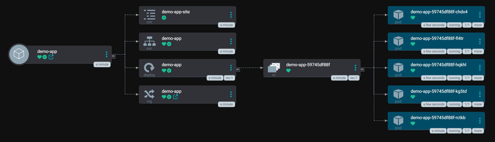
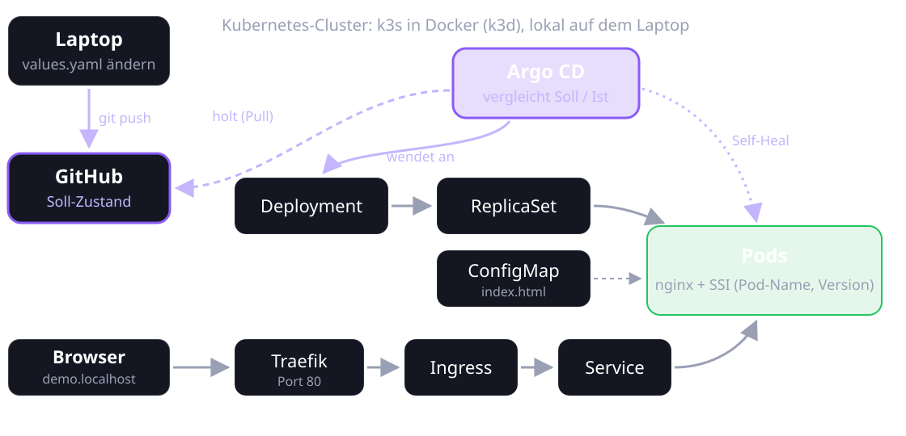
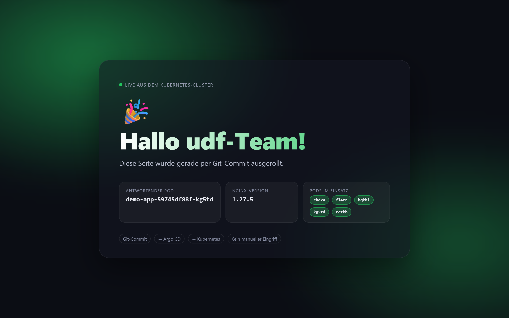

<!-- _class: lead -->
<!-- _paginate: false -->

# Kubernetes & GitOps: Deployen per **Git-Commit**

Warum das der Standard ist – und live auf meinem Laptop

<!--
(ca. 0:30)
Hallo zusammen! In den nächsten 20 Minuten zeige ich euch, wie man heute Software betreibt: mit Kubernetes und GitOps.
Erst ein bisschen Hintergrund, dann eine Live-Demo: Ich ändere eine Datei in Git, und ihr seht zu, wie sich eine Webseite von selbst aktualisiert.
-->

---

## Woran ich arbeite

- **Plattform- und Cloud-Migration** im öffentlichen Sektor
- Beispiel **eGesetzgebung**: Webanwendung des Bundes (BMI) für das Gesetzgebungsverfahren, vom Entwurf bis zur Verkündung
- Als **Open Source** auf Open CoDE veröffentlicht, damit auch Länder sie **nachnutzen** können
- Die Frage dahinter: *Läuft das auch bei uns?* → Betrieb muss **portabel** sein

Quellen: gitlab.opencode.de/bmi/e-gesetzgebung · EU-OSS-Katalog „E-Gesetzgebung“ (interoperable-europe.ec.europa.eu) · opencode.de

<!--
(ca. 1:30)
Kurz zu meinem Kontext: Ich arbeite an Plattform- und Cloud-Migrationen im öffentlichen Sektor.
Ein schönes Beispiel aus der öffentlichen Welt ist eGesetzgebung: die Plattform des Bundesinnenministeriums, mit der Gesetze elektronisch entstehen.
Der Bund hat sie als Open Source auf Open CoDE veröffentlicht, also der Code-Plattform der öffentlichen Verwaltung.
Damit stellt sich für ein Bundesland die Frage: Können wir das nachnutzen, und läuft das in unserer Infrastruktur?
Genau da kommen Kubernetes und GitOps ins Spiel.
(Nur öffentliche Infos – keine Projektdetails.)
-->

---

## Was ist Kubernetes?

- Ein **„Betriebssystem für das Rechenzentrum“**
- Du beschreibst den **Wunsch**, nicht die Schritte: *„3 Instanzen meiner App, Version 1.29“*
- Kubernetes sorgt dafür, dass es so **bleibt**:
  - startet abgestürzte Instanzen neu
  - verteilt die Last
  - Updates **ohne Ausfall**

<!--
(ca. 1:30)
Kubernetes ist so etwas wie ein Betriebssystem fürs Rechenzentrum. Statt einzelne Server zu pflegen, sage ich: Ich will drei Instanzen meiner App in Version 1.29.
Wie das passiert, ist Kubernetes' Job: Es verteilt die Instanzen, startet sie neu, wenn eine abstürzt, verteilt die Last und tauscht bei Updates eine nach der anderen aus, ohne Ausfall.
-->

---

## Soll-Zustand vs. Ist-Zustand

<!--
(ca. 1:00)
Das Grundprinzip heißt Reconciliation, also Abgleich.
Links steht der Soll-Zustand, den ich deklariere. Rechts das, was gerade wirklich läuft.
Kubernetes vergleicht beides ununterbrochen und gleicht an: Fällt ein Pod aus, startet ein neuer.
Merkt euch das Prinzip „Soll gegen Ist“, denn GitOps treibt es eine Ebene weiter.
-->

---

## Warum Industriestandard?

  

82 %
der Container-Nutzer betreiben Kubernetes in Produktion (2023: 66 %)

  

98 %
der Organisationen nutzen Cloud-native Techniken

  

66 %
derer, die GenAI-Modelle hosten, nutzen Kubernetes für Inferenz

 

- **Open Source** und herstellerneutral (CNCF)
- Läuft in **jeder Cloud** und **on-prem**

Quelle: CNCF Annual Cloud Native Survey, veröffentlicht 20.01.2026 – cncf.io/announcements/2026/01/20/

<!--
(ca. 1:30)
Ist das ein Nischenthema? Nein. Die aktuelle Umfrage der Cloud Native Computing Foundation vom Januar 2026:
82 Prozent der Container-Nutzer betreiben Kubernetes in Produktion, 2023 waren es noch 66.
98 Prozent der befragten Organisationen nutzen Cloud-native Techniken.
Und Kubernetes wird zur Plattform für KI: Zwei Drittel derer, die generative KI-Modelle selbst hosten, nutzen Kubernetes dafür.
Wichtig für uns: Es ist Open Source und herstellerneutral und läuft bei jedem Hyperscaler genauso wie im eigenen Rechenzentrum.
-->

---

## Was ist GitOps?

- **Git** ist die einzige Quelle der Wahrheit: App, Version, Konfiguration als Text
- Ein **Controller im Cluster** (hier: Argo CD) holt sich den Stand und **gleicht ab**
- Änderungen nur per **Commit** und Review, nie per Hand am Server

<!--
(ca. 1:00)
GitOps überträgt dieses Prinzip auf den ganzen Betrieb: Der Soll-Zustand steht nicht in irgendeinem Kopf oder Wiki, sondern in Git.
Ein Controller im Cluster, bei uns Argo CD, schaut regelmäßig ins Repo und gleicht den Cluster an.
Rechts seht ihr, wie Argo CD das darstellt: Die App, darunter Deployment, ReplicaSet, Pod, Service, Ingress. Alles grün heißt: Soll gleich Ist.
-->

---

## Der GitOps-Kreislauf

<!--
(ca. 1:00)
Der Kreislauf: Ich ändere etwas und pushe es ins Repo. Argo CD holt sich den Stand, das ist ein Pull, kein Push von außen.
Mit Sync wendet es die Änderung im Cluster an. Und wenn jemand am Cluster vorbei etwas ändert, merkt Argo CD die Abweichung und stellt den Git-Stand wieder her: in der Demo per Klick auf SYNC, im echten Betrieb automatisch (Self-Heal).
Rollback ist einfach git revert: der letzte Commit wird rückgängig gemacht.
-->

---

## Warum das zukunftssicher ist

  
<b>Portabel</b>Offene Standards statt Lock-in – digitale Souveränität

  
<b>Nachvollziehbar</b>Jede Änderung ist ein Commit: wer, was, wann, mit Review

  
<b>Reproduzierbar</b>Neuer Cluster? Ein Befehl, und alles steht wieder

  
<b>Sicher</b>Niemand braucht direkten Zugriff auf den Cluster

Die reifsten Organisationen setzen GitOps intensiv ein: <strong>58 %</strong> der „Innovators“ vs. <strong>23 %</strong> der „Adopters“.

Quelle: CNCF Annual Cloud Native Survey, 20.01.2026

<!--
(ca. 1:30)
Warum ist das zukunftssicher?
Portabel: offene Standards. Das Repo läuft auf jedem Kubernetes, egal ob Cloud oder eigenes Rechenzentrum. Gerade im öffentlichen Sektor heißt das digitale Souveränität.
Nachvollziehbar: Jede Änderung hat einen Autor, einen Zeitstempel und idealerweise ein Review. Das ist der Audit-Trail gratis dazu.
Reproduzierbar: Ein neuer Cluster ist ein Befehl, das zeige ich gleich.
Sicher: Niemand braucht Admin-Zugriff auf den Cluster, auch keine Pipeline von außen.
Laut CNCF nutzen die reifsten Organisationen GitOps mehr als doppelt so häufig wie die Einsteiger.
-->

---

## Der Demo-Aufbau

<!--
(ca. 1:00)
Mein Aufbau für heute läuft komplett auf diesem Laptop: ein k3s-Cluster in Docker. Darin Argo CD und Traefik als Eingangstür.
Das Repo liegt öffentlich auf GitHub. Die Webseite ist ein einfacher nginx. Er schreibt per Server Side Include den Namen des Pods und seine Version in die Seite. So sehen wir gleich, welcher Pod antwortet.
Die Seite fragt sich selbst alle 0,7 Sekunden neu ab, deshalb sehen wir Änderungen ohne Neuladen.
-->

---

## Live-Demo

<ol class="steps">
  <li>Code in GitHub zeigen</li>
  <li>Leeres Argo CD</li>
  <li>Argo CD mit dem Repo verbinden → Webseite da</li>
  <li><code>values.yaml</code> ändern → SYNC</li>
  <li>Deployment löschen → SYNC heilt</li>
  <li>Auf 5 Pods skalieren → SYNC</li>
</ol>

<!--
(ca. 9:00, diese Folie bleibt während der Demo stehen)
Ablauf siehe docs/Anleitung.md, Kurzfassung:
1. GitHub: chart/files/index.html und chart/values.yaml zeigen.
2. Argo CD ist leer, demo.localhost gibt 404.
3. Settings → Repositories → CONNECT REPO (VIA HTTPS, Repo-URL) → Successful. Dann + NEW APP → EDIT AS YAML → argocd/demo-app.yaml einfügen → CREATE → SYNC. F5 auf der Webseite.
4. values.yaml: title, emoji, accentColor → git commit -am "Neuer Look"; git push → REFRESH → OutOfSync (DIFF zeigen) → SYNC. Seite springt kurz zwischen alt und neu: Rolling Update!
5. Beim Deployment ⋮ → Delete → App OutOfSync, Pod-Chips weg → SYNC → alles wieder da.
6. replicaCount: 5 → push → REFRESH → SYNC → 5 Pods im Baum und als Chips.
-->

---

## Fazit

1. **Kubernetes** hält den Soll-Zustand, den du beschreibst, von selbst
2. **GitOps** macht Git zur einzigen Wahrheit: jede Änderung ein Commit, Rollback per Revert
3. **Offen und portabel** → zukunftssicher, gerade für die öffentliche Verwaltung

<!--
(ca. 1:00)
Drei Dinge zum Mitnehmen:
Erstens: Kubernetes hält den Zustand, den ich beschreibe, von selbst.
Zweitens: GitOps macht Git zur einzigen Wahrheit. Jede Änderung ist ein Commit, und Rollback ist ein Revert.
Drittens: Das Ganze ist offen und portabel, deshalb ist es zukunftssicher, gerade für die Verwaltung.
-->

---

<!-- _class: lead -->
<!-- _paginate: false -->

# Fragen?

Demo zum Nachbauen: **github.com/GreenPickle392/gitops-demo**

<!--
Danke! Das Repo ist öffentlich: Mit einem Befehl baut ihr die ganze Demo auf eurem eigenen Rechner nach. Anleitung liegt in docs/Anleitung.md.
-->
