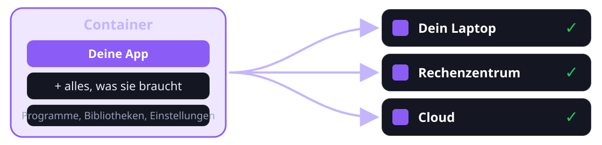
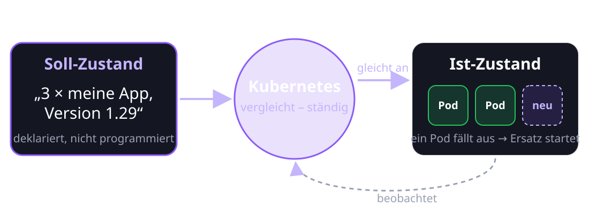
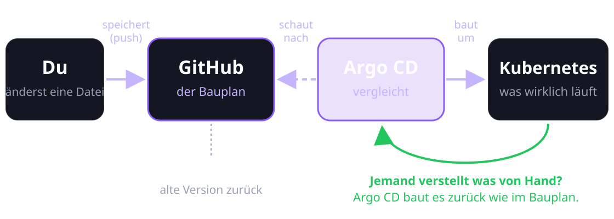

<!-- _class: lead -->
<!-- _paginate: false -->

# Software ausliefern per **Git-Commit**

Container, Kubernetes und GitOps – einfach erklärt, mit Live-Demo

<!--
(ca. 0:30)
Hallo zusammen! In den nächsten 20 Minuten zeige ich euch, wie man heute Software betreibt.
Keine Sorge, ihr braucht kein Vorwissen. Wir fangen ganz vorne an: Was ist ein Container?
Am Ende ändere ich live eine Datei, und ihr seht zu, wie sich eine Webseite von selbst umbaut.
-->

---

## Was ist ein Container?

  
<b>Überall gleich</b>Kein „bei mir lief's aber“ mehr

  
<b>Schnell</b>Startet in Sekunden

  
<b>Sparsam</b>Viele passen auf einen Rechner

  
<b>Getrennt</b>Apps stören sich nicht gegenseitig

<!--
(ca. 2:30)
Stellt euch einen Schiffscontainer vor. Egal, was drin ist: Jedes Schiff, jeder Kran, jeder LKW kann ihn transportieren, weil er genormt ist.
Ein Software-Container ist dasselbe für Programme: Ich packe meine App zusammen mit allem, was sie braucht, in eine Kiste. Also die passenden Programme, Bibliotheken und Einstellungen.
Diese Kiste läuft dann auf meinem Laptop genauso wie auf einem Server oder in der Cloud.
Warum ist das gut?
Überall gleich: Das klassische „Bei mir lief's aber“ gibt es nicht mehr.
Schnell: Ein Container startet in Sekunden, nicht in Minuten.
Sparsam: Er bringt kein ganzes Betriebssystem mit, deshalb passen viele auf einen Rechner.
Getrennt: Jede App hat ihre eigene Kiste. Wenn eine Probleme macht, stört sie die anderen nicht.
-->

---

## Kubernetes: der Chef der Container

- Du sagst, **was** du willst, Kubernetes sorgt dafür, dass es **so bleibt**
- Ein laufender Container heißt bei Kubernetes **Pod**

82 % der Firmen mit Containern nutzen Kubernetes im Echtbetrieb. Quelle: CNCF Annual Cloud Native Survey, 20.01.2026

<!--
(ca. 2:00)
Wenn man viele Container hat, braucht man jemanden, der aufpasst. Das ist Kubernetes.
Ich sage Kubernetes nicht Schritt für Schritt, was es tun soll. Ich sage nur meinen Wunsch: „Ich will drei Kopien meiner Webseite.“
Kubernetes schaut ständig nach, ob das stimmt. Stürzt eine Kopie ab, startet es sofort eine neue. Ohne dass ein Mensch nachts aufstehen muss.
Ein Wort noch, weil es gleich in der Demo auftaucht: Einen laufenden Container nennt Kubernetes „Pod“.
Kubernetes ist übrigens kein Nischenthema: Laut einer großen Umfrage vom Januar 2026 nutzen 82 Prozent der Firmen mit Containern Kubernetes im Echtbetrieb.
-->

---

## GitOps: Git ist der Bauplan

<!--
(ca. 2:00)
Bleibt die Frage: Woher weiß Kubernetes, was ich will? Hier kommt GitOps ins Spiel.
Git kennen viele von euch: Dort liegt Code, und jede Änderung wird gespeichert, mit Name und Datum.
Bei GitOps liegt dort auch der Bauplan für den Betrieb: Welche App, welche Version, wie viele Kopien.
Argo CD ist ein Helfer im Cluster. Er schaut regelmäßig in Git nach und vergleicht: Passt das, was läuft, zum Bauplan? Wenn nicht, baut er um.
Und wenn jemand von Hand etwas verstellt, baut Argo CD es zurück, wie es im Bauplan steht.
Hab ich einen Fehler gemacht, hole ich in Git einfach die alte Version zurück.
-->

---

## Warum das gut ist

  
<b>Nachvollziehbar</b>Jede Änderung hat einen Namen und ein Datum

  
<b>Rückgängig machbar</b>Fehler? Alte Version zurückholen, fertig

  
<b>Wiederholbar</b>Neuer Rechner? Alles steht in Minuten wieder

  
<b>Offen</b>Läuft in jeder Cloud und im eigenen Rechenzentrum

Beispiel: Der Bund hat seine Software <strong>eGesetzgebung</strong> als Open Source auf Open CoDE veröffentlicht, damit auch andere sie nutzen können. Das klappt, wenn sie überall gleich läuft.

Quelle: gitlab.opencode.de/bmi/e-gesetzgebung · opencode.de

<!--
(ca. 1:30)
Warum macht man das so?
Nachvollziehbar: Ich sehe in Git genau, wer wann was geändert hat.
Rückgängig machbar: Ein Fehler ist schnell repariert, ich hole einfach die alte Version zurück.
Wiederholbar: Geht ein Rechner kaputt, steht auf einem neuen in Minuten alles wieder, denn der Bauplan liegt ja in Git.
Offen: Das sind offene Standards. Es läuft bei jedem Cloud-Anbieter und im eigenen Rechenzentrum.
Ein Beispiel aus der öffentlichen Verwaltung: Der Bund hat die Software eGesetzgebung, mit der Gesetze elektronisch entstehen, als Open Source auf Open CoDE veröffentlicht. Damit andere sie bei sich betreiben können, muss sie überall gleich laufen. Genau dabei helfen Container.
(Nur öffentliche Infos – keine Projektdetails.)
-->

---

## Was läuft auf meinem Laptop?

<!--
(ca. 1:00)
So sieht die Demo aus. Auf meinem Laptop läuft ein kleines Kubernetes.
Darin laufen zwei Dinge: Argo CD und meine Webseite. Die Webseite ist ein einfacher Webserver namens nginx in einem Container.
Der Bauplan liegt auf GitHub. Ich ändere dort eine Datei, Argo CD schaut nach und baut die Webseite um.
Am Anfang läuft eine Kopie der Webseite, am Ende fünf.
-->

---

## Live-Demo

<ol class="steps">
  <li>Code in GitHub zeigen</li>
  <li>Argo CD ist noch leer</li>
  <li>Argo CD mit GitHub verbinden → Webseite ist da</li>
  <li>Titel und Farbe ändern → SYNC</li>
  <li>Webseite in Argo CD löschen → SYNC baut sie neu</li>
  <li>Auf 5 Kopien hochdrehen → SYNC</li>
</ol>

<!--
(ca. 9:00, diese Folie bleibt während der Demo stehen)
Ablauf siehe docs/Anleitung.md, Kurzfassung:
1. GitHub: chart/files/index.html und chart/values.yaml zeigen.
2. Argo CD ist leer, demo.localhost gibt 404.
3. Settings → Repositories → CONNECT REPO (VIA HTTPS, Repo-URL) → Successful. Dann + NEW APP → EDIT AS YAML → argocd/demo-app.yaml einfügen → CREATE → SYNC. F5 auf der Webseite.
4. values.yaml: title, emoji, accentColor → git commit -am "Neuer Look"; git push → REFRESH → OutOfSync (DIFF zeigen) → SYNC. Die Seite springt kurz zwischen alt und neu: Der neue Pod startet, bevor der alte geht, so gibt es keinen Ausfall.
5. Beim Kasten demo-app (deploy) ⋮ → Delete → App gelb, Pod-Chips weg → SYNC → alles wieder da.
6. replicaCount: 5 → push → REFRESH → SYNC → 5 Pods im Baum und als Chips.
-->

---

## Zum Mitnehmen

1. **Container:** App plus alles, was sie braucht, in einer Kiste. Läuft überall gleich.
2. **Kubernetes:** passt auf die Container auf und repariert von selbst.
3. **GitOps:** Git ist der Bauplan. Argo CD sorgt dafür, dass es so läuft.

Fragen?

Demo zum Nachbauen: <strong>github.com/GreenPickle392/gitops-demo</strong>

<!--
(ca. 1:30)
Drei Dinge zum Mitnehmen:
Ein Container ist eine Kiste mit meiner App und allem, was sie braucht. Sie läuft überall gleich.
Kubernetes passt auf die Container auf und repariert von selbst.
Und bei GitOps ist Git der Bauplan. Argo CD sorgt dafür, dass genau das läuft, was dort steht.
Habt ihr Fragen? Das Repo ist öffentlich, die Anleitung zum Nachbauen liegt in docs/Anleitung.md.
-->
